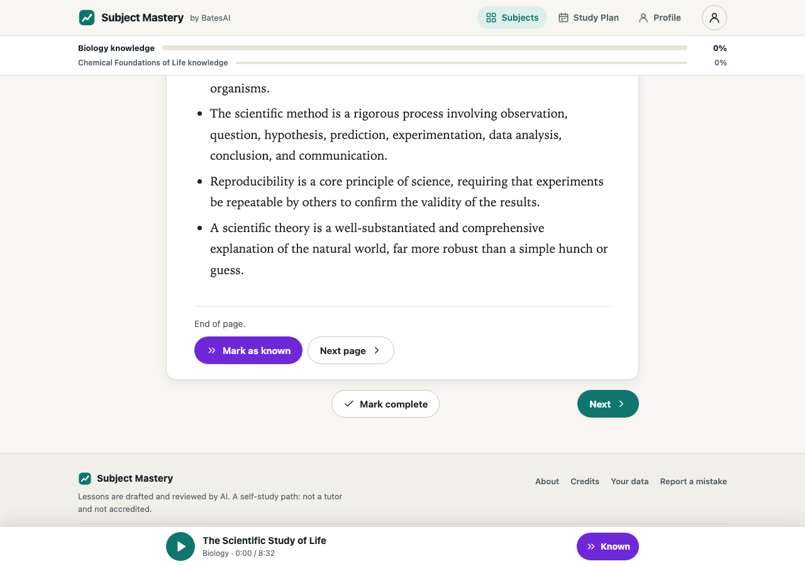
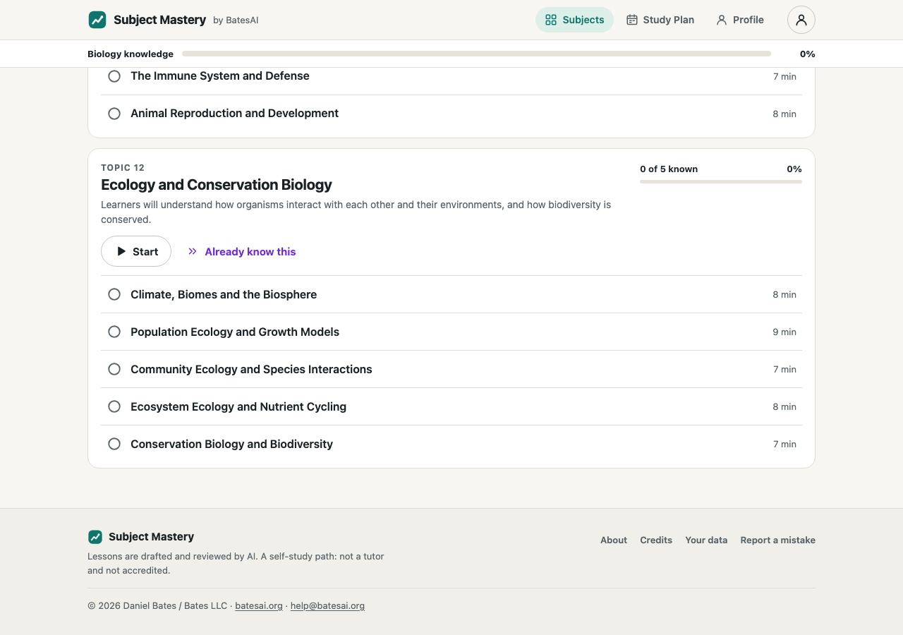
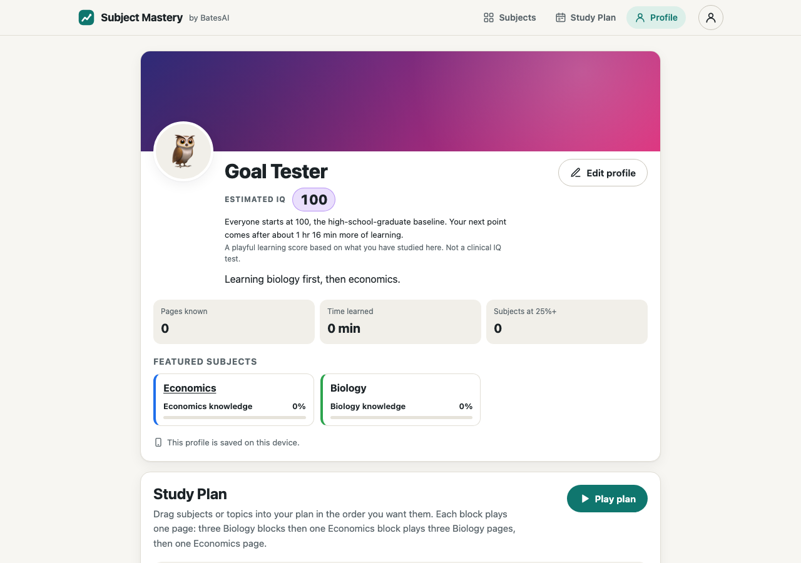

# Subject Mastery

Copyright (c) 2026 Daniel Bates / Bates LLC. All rights reserved.
[Website](https://batesai.org/subjectmastery/) · [BatesAI](https://batesai.org) · [help@batesai.org](mailto:help@batesai.org)

Learn a subject by listening or reading. Skip what you already know, resume where you stopped, and build a personal Study Plan that plays subjects in your chosen order.

**Initial public version:** 316 available lessons in five subjects, including 250 recorded lessons (about 30 hours). Mathematics adds 66 lessons with device speech. The repository holds 639 written lessons across ten subjects; five additional subjects remain unpublished drafts pending further review and narration. The catalog includes 44 subject paths for future expansion. Content starts with college foundations and progresses to intermediate material.

| Subject | Available pages | Narration |
|---|---:|---|
| Biology | 61 | Recorded John voice |
| Economics | 61 | Recorded John voice |
| World History | 63 | Recorded John voice |
| Biblical Studies & Theology | 65 | Recorded John voice |
| Mathematics | 66 | Device speech, or read the text |

Lessons are original AI-assisted texts with review provenance. Further expert corrections are welcome. See [content status](docs/CONTENT_STATUS.md) and [Mathematics review](docs/MATH_REVIEW.md).

| Lesson player | Subject path | Profile and Study Plan |
|---|---|---|
|  |  |  |

## What you can do

| Feature | Behavior |
|---|---|
| Subject knowledge | A persistent subject bar and topic bar grow after each completed or known page. The fill uses the exact fraction, so a single page visibly moves the bar. |
| Already Known | Skip from the top button, the bottom text button, the mini-player, or the K key. Each skip counts toward knowledge; an undo window protects accidental clicks. |
| Continuous listening | One Play click starts a lesson. Finishing its audio completes the page and starts the next. Recordings are at most ten minutes at 1x. Device speech times are estimates. |
| Resume or choose any page | Selecting a subject resumes at its first unfinished page; the full topic tree lets you start anywhere. |
| Study Plan | Drag subjects or nested topics into blocks on your profile. One block means one next unfinished lesson. Three Biology blocks then one Mathematics block play three consecutive Biology lessons, followed by Mathematics. Touch and keyboard controls are included. |
| Personal profile | Customize your name, photo/initials/emoji, bio, accent, banner and featured subjects. |
| Estimated IQ | The requested display starts at 100 and increases with learning. It is explicitly a playful learning score, not a measured or clinical IQ. |
| Save your progress | Browser storage works without an account. Google sign-in on batesai.org syncs progress, profile and Study Plan across devices. Export/reset controls are on the Account page. |
| Mac beta | A self-contained Swift .app bundles the site and recordings, runs a loopback server, and keeps local progress between launches. |

## Run locally

The player uses vanilla JavaScript ES modules and CSS with no runtime dependencies or build tool. Python assembles curriculum data into a static site. Run commands from this repo:

```sh
python3 -B pipeline/build.py
python3 -m http.server 8765 --bind 127.0.0.1 --directory ~/Downloads/subject-mastery-build/dist
```

Open `http://127.0.0.1:8765/`. Without recordings, lessons use browser speech. This basic server is fine for reading; the Mac app or a host with HTTP Range support is better for audio seeking.

| Environment variable | Purpose |
|---|---|
| `SM_REPO` | Canonical source checkout when running a local mirror |
| `SM_BUILD` | Build workspace; defaults to `~/Downloads/subject-mastery-build` |
| `SM_CONTENT_DIR`, `SM_WEB_DIR`, `SM_DIST_DIR` | Override content, player source, or build destination |
| `SM_AUDIO_DIR` | Recording folder; existing John masters use `audio-en_US-john-medium` |
| `SM_VOICES_DIR`, `SM_PIPER_PYTHON` | Installed Piper voice models and Python environment |
| `SM_SECRETS_FILE` | Ignored JSON credential file, or use provider environment variables |
| `SM_APP_SITE` | Verified static build to bundle in the Mac beta |

The downloadable release includes a ready-built site with recordings. Serve its extracted directory with any static host supporting HTTP Range requests. Only batesai.org has the account API; other hosts run locally without syncing.

## Check and build the Mac beta

```sh
node --test web/tests/*.test.mjs
python3 -B -m unittest discover -s pipeline/tests
python3 -B pipeline/build.py --check
python3 -B tools/privacy_scan.py .
# Browser QA needs Python Playwright, its matching Chromium, and ffmpeg:
python3 -B web/tests/make_fixture.py ~/Downloads/subject-mastery-build/fixture-dist
python3 -B web/tests/e2e_playwright.py ~/Downloads/subject-mastery-build/fixture-dist
python3 -B web/tests/e2e_goal.py --dist ~/Downloads/subject-mastery-build/dist
python3 -B web/tests/e2e_math_plan.py ~/Downloads/subject-mastery-build/dist ~/Downloads/subject-mastery-build/screens-math
# macOS + Xcode command-line tools, archives the previous app and installs once:
SM_APP_SITE=~/Downloads/subject-mastery-build/dist bash app/build_app.sh
```

GitHub Actions validates player logic, content builds, the ten-minute recording gate and privacy. Browser tests run headlessly in isolated contexts and use mocked accounts. The Mathematics plan test uses a silent test voice to verify recording-to-speech transitions; it does not assess pronunciation. Validation details are in [docs/VALIDATION.md](docs/VALIDATION.md).

## Repository map

| Directory | Role |
|---|---|
| `web/` | Responsive player, profile, plan, local persistence and API syncing |
| `content/` | Catalog, nested subject trees, Markdown lessons and per-page provenance |
| `pipeline/` | Free-tier drafting/review, local narration, static build and validation |
| `site-integration/` | batesai.org API snapshots, migrations and integration checks |
| `app/` | Swift beta app, loopback server and app build script |
| `docs/` | Goal, contract, source references, content review, validation and successor handoff |
| `tools/` | Privacy scan for files eligible for git |
| `archive/` | Retired approaches and dated setup/deployment records |

The canonical source lives in the Google Drive Code workspace. Build artifacts, audio masters, logs and browser screenshots live in Downloads. Personal machine paths are in ignored `docs/LOCAL_PATHS.md`; credentials and learner exports are never tracked.

## Next development paths

- Review and narrate the remaining Chemistry, Psychology, Computer Science, US History and Church History drafts.
- Add quick knowledge checks and spaced repetition to distinguish completion from retained understanding.
- Expand the catalog into deeper college and advanced paths, preserving published lesson IDs.
- Add offline web caching and accessible mathematical notation alongside spoken explanations.
- Move to subjectmastery.com or subjectmastery.org after domain acquisition; no domain was purchased.
- Improve narrator pronunciations and add consistent Mathematics recordings.

[docs/HANDOFF.md](docs/HANDOFF.md) records architectural decisions, current state and alternatives for the next contributor. Related open-licensed projects were researched before development; see [docs/RELATED_PROJECTS.md](docs/RELATED_PROJECTS.md).

## License and contributions

Public source is licensed under **PolyForm Noncommercial 1.0.0 with a commercial-use rider**. Noncommercial use is free. Commercial use requires a separate agreement with Bates LLC; standard terms are 10% of gross revenue attributable to the product/service incorporating the software. This is source available, not OSI open source. See [LICENSE](LICENSE).

The small Piper adapter is separately GPL-3.0-or-later; reused icons retain their original ISC/MIT notices. See [NOTICE](NOTICE) and `LICENSES/`. Piper and its voice models are external tools, not included in git.

Report bugs and factual corrections through GitHub issues or **help@batesai.org**. Include the lesson or screen, expected behavior and a way to reproduce it. Pull requests are welcome.
